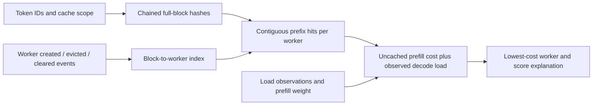

# Prefix-Aware LLM Routing

A dependency-free Python simulator that routes tokenized prompts using an event-driven prefix-cache index and observed worker load. It makes the tradeoff visible: a worker with fewer cached tokens can win when its decode load is lower.

This is an educational CPU simulation. It stores hashes, not KV tensors, and performs no model inference, network calls, GPU scheduling, or latency measurement. Its relative scores are not seconds or predictions of production throughput.

## Run

Use Python 3.10 or newer. No installation, API key, model download, or third-party package is needed.

```shell
python -B -m prefix_router examples/demo.json
python -B -m unittest discover -s tests -v
```

The CLI emits JSON to standard output. Redirect it to a file if desired. Input errors print `error: ...` to standard error and exit with status 2.

The demo starts with ten requested blocks. Three workers have respectively 2, 5, and 8 leading blocks cached, and decode loads of 10, 5, and 9. Their scores are 18, 10, and 11, so `worker-2` wins. Subsequent operations demonstrate eviction, a new cache event, an incomplete tail, tenant isolation, cache clearing, and a changed load observation.

## How it works

1. Split integer token IDs into fixed-size blocks. Only full blocks earn cache credit.
2. Seed a SHA256 hash chain with the block size, model revision, tokenizer revision, tenant, and adapter. Each block hashes the preceding digest and its own token IDs. A changed token changes that block's hash and all later hashes.
3. Consume explicit `created`, `evicted`, or `cleared` events. Maintain block-to-worker ownership without storing prompt text or KV tensors.
4. Walk a request's block hashes in order for each worker, stopping at its first missing block. Later resident blocks cannot repair a missing prefix.
5. Choose the minimum `decode_load + prefill_weight * uncached_prefill_blocks`. Ties use the worker name for deterministic results.

Here, `uncached_prefill_blocks = (prompt_tokens - reused_full_block_tokens) / block_size`. An uncached tail contributes a fractional block rather than being dropped or earning cache credit. Decode load uses the same relative block-equivalent units; the scenario supplies those observations. A weight of zero ignores cache savings, and larger weights favor reuse more strongly.

Routing does not mutate load or assume that execution has cached anything. Only a later cache event establishes residency. The Python event API requires a monotonically increasing sequence per worker: duplicates and older events are ignored; a gap clears that worker's previous ownership before applying the new event. This conservative policy can undercount hits after lost events. A restarted producer needs a fresh index or an externally managed stream epoch; recovery snapshots and producer epochs are outside this simulation.



## Scenario format

The root object has `workers` (a map of names to finite nonnegative decode loads) and `operations` (an ordered list). Optional keys are `block_size` (positive integer, default 16), `prefill_weight` (finite nonnegative number, default 1), and `scope`.

Scope keys are `model_revision`, `tokenizer_revision`, `tenant`, and `adapter`. Defaults are toy identities; provide actual identities when adapting the algorithm. An operation's `scope` fully replaces the scenario scope rather than merging it. Tenant isolation here only separates cache identities; it is not an authentication or authorization system.

| Operation | Fields and effect |
| --- | --- |
| `cache` | `worker`, `tokens`, optional `scope`: emit created events for all full blocks. |
| `evict` | `worker`, `tokens`, optional `scope`, optional `block_indexes`: evict all identified full blocks or the specified zero-based block indexes. |
| `clear` | `worker`: remove all that worker's indexed hashes. |
| `load` | `worker`, `decode_load`: update an external load observation. |
| `route` | `tokens`, optional `scope`, optional `label`: produce one explained decision. |

Tokens are ordered unsigned 32-bit integers, not text or embeddings. Routing requests must be nonempty. Unknown fields, unknown workers, invalid block indexes, non-finite numbers, and negative values fail validation. Empty cache events are allowed when a prompt contains no complete block.

## Code map

| File | Responsibility and relationship |
| --- | --- |
| `prefix_router/__init__.py` | Exposes the small public API for hashing, cache events, indexing, and routing. |
| `prefix_router/core.py` | Validates token/scope identities; computes chained hashes; applies ordered lifecycle events; scores every worker and explains the selection. |
| `prefix_router/__main__.py` | Validates and replays JSON operations through the core API; implements the command-line entry point and error handling. |
| `examples/demo.json` | Complete synthetic three-worker event and load scenario consumed by the CLI. |
| `tests/test_router.py` | Checks hash-chain identity, scope separation, contiguous hits, event order/eviction, load tradeoffs, tail accounting, validation, and CLI behavior. |
| `requirements.txt` | Records that only the Python standard library is required. |
| `.gitignore` | Excludes bytecode, environments, secrets, logs, and generated data/results. |
| `README.md` | Describes the algorithm, scenario contract, limits, and commands. |

## Upstream concepts and limits

The project independently implements a small teaching model of these open-source ideas:

- [vLLM](https://github.com/vllm-project/vllm) describes [chained prefix-cache block identity](https://docs.vllm.ai/en/latest/design/prefix_caching/). This simulator's hash format is its own and is not wire-compatible with engine events.
- [llm-d](https://github.com/llm-d/llm-d) provides a [precise prefix-cache routing guide](https://github.com/llm-d/llm-d/blob/main/guides/precise-prefix-cache-routing/README.md) that consumes engine cache events. This project replays local JSON operations and does not implement its ZMQ transport or deployment.
- [NVIDIA Dynamo](https://github.com/ai-dynamo/dynamo) documents the simple additive prefill/decode score in its [v0.7 router design](https://docs.dynamo.nvidia.com/dynamo/v-0-7-0/components/router). The simulator deliberately models that small cost function. Current production router versions have additional terms and policies.

Block size must agree with an actual engine; 16 is an illustrative default here, not a universal engine configuration. The worker pool is assumed to serve compatible model contexts. Model/tokenizer/adapter revisions and tenant scope must describe the real execution context. Multimodal identity, sliding windows, KV transfers, queue timing, cache capacity/LRU policy, generated-token caching, asynchronous event transport, and real GPU or model performance are not implemented or verified.
